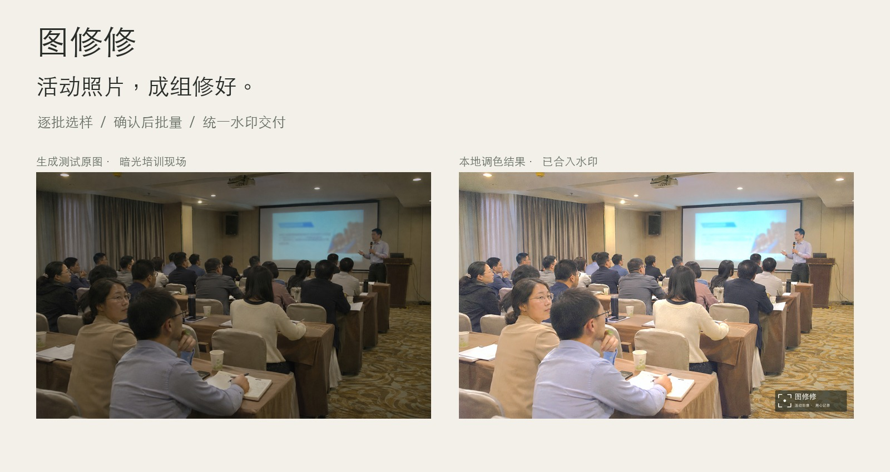
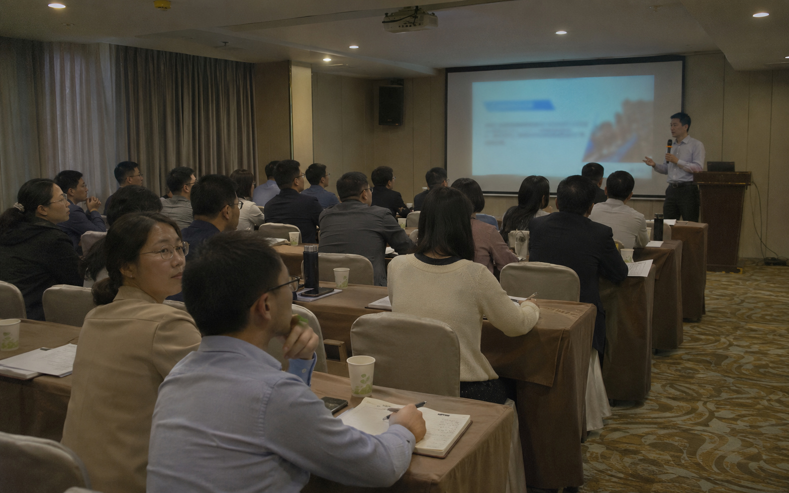
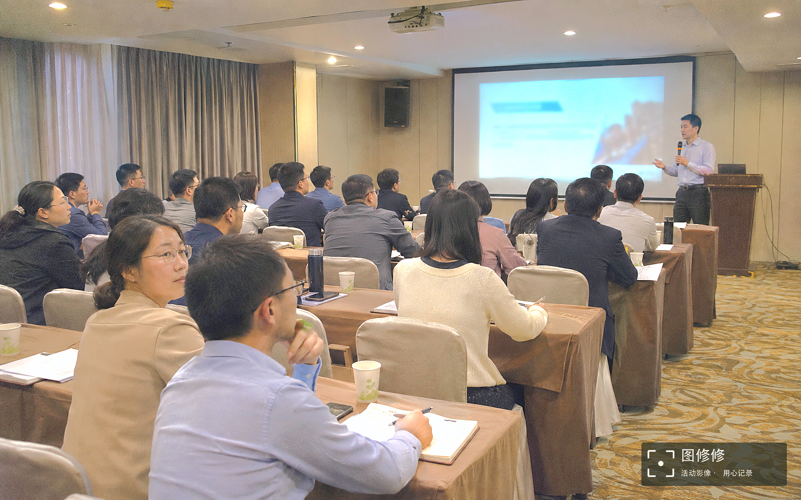
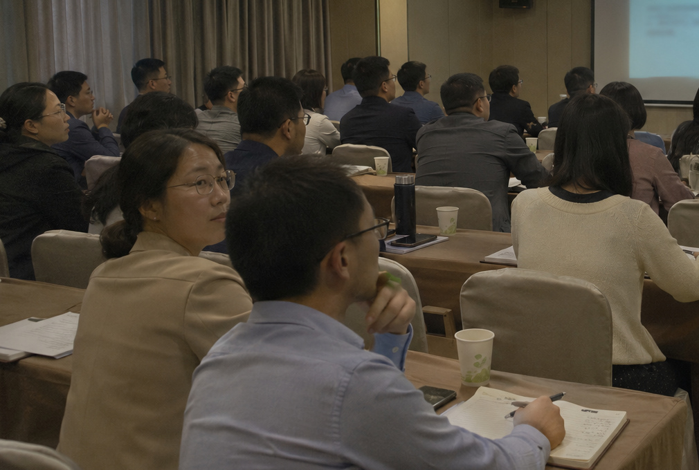
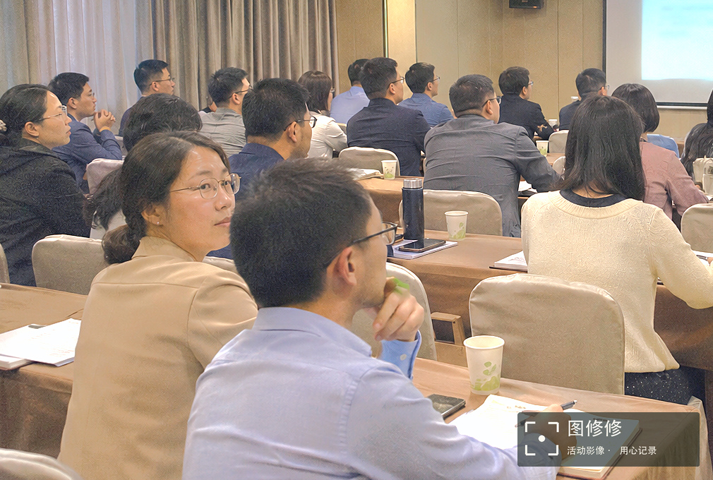
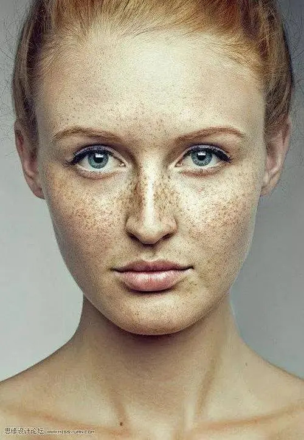
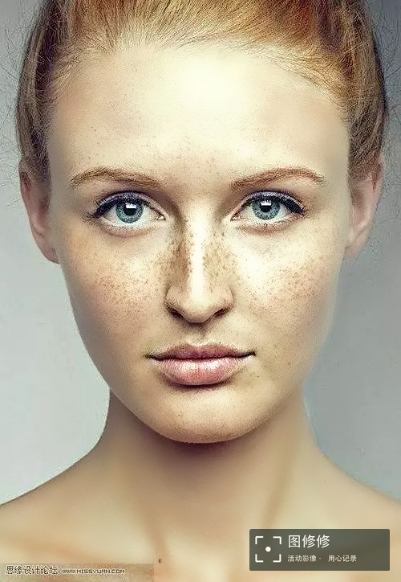

<p align="center"></p>
<h1 align="center">图修修</h1>
<p align="center">活动照片，成组修好。逐批选样，确认后批量处理。</p>
<p align="center"><code>Skill 2.6.0</code> · <code>本地处理</code> · <code>原片保留</code> · <code>先选样，再批量</code></p>
<p align="center"><a href="https://img.chenshi.ai/">在线网站</a> · <a href="#看处理前后">效果对比</a> · <a href="#下载哪个包">下载</a> · <a href="#第一次使用">第一次使用</a> · <a href="#适用范围与限制">适用范围</a> · <a href="docs/INSTALL.md">完整安装指引</a></p>

面向会议、论坛、培训等活动照片的本地批量修图 Skill，也可检查商务人像细节。把照片文件夹交给支持本地 Skill 的 AI 助手：先分析本批照片，生成可比较的试修样片，再由你确认方案、强度和水印，继续批量处理。

> 这是在电脑上运行的 Skill，需要先准备 Python 和独立运行环境。介绍网站负责展示、下载和指引，照片处理在你的本机完成。

## 看处理前后

培训现场是一张特意偏暗的生成测试素材，用同一张底图实际运行本地调色与水印合成。全景与局部是同图的两种查看方式；人像继续展示已有实测样片。生成底图不作为真实活动或分割准确率证据。

| 培训原图（生成测试素材） | 本地优化与水印输出 |
| --- | --- |
|  |  |

| 同图局部原图 | 同图局部优化与水印 |
| --- | --- |
|  |  |

| 人像实测原片 | 柔和人像试修与水印 |
| --- | --- |
|  |  |

右下角水印已合入输出图片像素，网站不是用CSS临时盖住照片。[素材来源、完整生成提示词与本地处理参数](docs/DEMO-ASSETS.md)。原图署名保留，既有照片公开展示授权已由提供者确认。正式处理仍按每批实际照片选样。

## 工作台怎样配合你

- 上方对比同一张照片的原片与试修效果，检查整图与细节。
- 下方并排查看三版水印叠加效果，点击后按窗口尺寸放大；右侧先调修片，再选独立水印素材。
- 把“还不够亮”“肤色偏冷”等文字要求转成新样片，确认后再继续，旧效果不会因为一句修改要求就被自动批准。
- 保存原片、选区、配方、预览和完成记录；新增同场照片先判断是否落在已有确认范围，出现新条件则补样。

## 自动选皮肤，怎样避免半张脸的分界

四个随包模型分别承担皮肤语义、人脸定位、局部头发排除和五官定位。整图做观察，人脸局部从整理方向后的原片像素裁出；调色用的皮肤范围与磨皮用的纹理范围分开保存。

小脸、遮挡或五官不可靠时，暂缓所在整块连续皮肤的磨皮并标记复核，避免沿人脸框截断而形成分界。自动初选与细化减少逐张描选的工作；它仍不能保证所有可见皮肤都准确，技术核对与效果确认继续保留。

## 下载哪个包

| | 普通分享包 | Mac Apple 芯片离线包 |
| --- | --- | --- |
| 体积 | 19.6 MB | 139.2 MB |
| 四个模型 | 已包含 | 已包含 |
| 首次安装运行库 | 需要联网 | 对应环境可离线安装 |
| Python | 已有 3.12—3.14 | 已有 3.14 |
| 系统与芯片 | 支持 macOS／Linux 的准备入口，接收者仍需自检 | macOS、Apple 芯片（M 系列） |
| 本轮实机验证 | Mac Apple 芯片、Python 3.14 | Mac Apple 芯片、Python 3.14 |

两种包都不包含 Python 安装程序。准备好的独立环境约 400 MB，另需为原片、母版与成品预留空间。Windows 尚未适配；Linux、其他 Python 版本、Intel Mac 与旧系统没有在本轮完成实机验收。

[在图修修网站选择正确的包](https://img.chenshi.ai/#download)。两种 ZIP 作为独立的版本附件提供；文件名、精确大小与 SHA-256 见 [下载清单](site/downloads.json)。网站与此清单同步生成，普通包和离线包使用不同文件名。

## 第一次使用

1. **检查电脑。** 本轮推荐已验证的 Mac Apple 芯片与 Python 3.14。没有 Python 时，先安装受支持版本；可让助手检查并指导。
2. **下载、解压。** 保留完整的 `event-photo-retouch` 文件夹，不只复制 `SKILL.md`。
3. **准备环境。** Mac 双击“一键准备.command”，读完提示，输入 `y`。普通包首次联网安装运行库；匹配的离线包使用随包运行库。入口不会把这些库安装到系统 Python。
4. **交给助手。** 把完整文件夹添加到支持本地 Skill 的助手中，明确要求安装／使用此 Skill，并检查四模型实际推理自检。
5. **交给照片。** 先要试修样片，再选择效果和水印。缺色彩标记时，由你决定是否允许按 sRGB 试修。

可以这样开始：

> 使用图修修 Skill 处理这个照片文件夹。先分析本批照片并给我比较样片，我确认后再批量处理。有水印需求时先给我看三版。

首次准备只需一次；拉动参数会复用缓存选区，不会每次重新安装或运行全部模型。换电脑需要在新机器重新准备，不复制旧虚拟环境。

## 实测结果

| 检查 | 本轮结果与解释 |
| --- | --- |
| 自动回归 | 108 项通过 |
| 批次契约 | 38 项通过 |
| 模型与安装 | 四模型实际调用自检通过；独立目录、全新缓存的离线安装通过 |
| 三张原图 | 均生成皮肤、纹理、保护三张蒙版，并成功复用缓存 |
| 指定人像检查区 | 额头上下、双颊、颈部、双肩七处检查区全部覆盖；不是模型准确率 |
| 磨皮排除区 | 仅磨皮的最高强度诊断中，五官排除核心像素保持一致 |
| 选区计算时间 | 本机三图约 0.60、1.00、0.09 秒；模型已加载，不含启动、照片读写、修图与导出 |

三张现有图片不是独立标注集。人脸候选数不是准确人数，五官定位成功也不等于完成磨皮；没有启用无条件机器自动放行。详情见[实测说明](docs/TESTED-RESULTS.md)。

## 适用范围与限制

适用于活动、会议和商务人像的非生成式调色、皮肤候选、受限修肤、水印与交付流程。原件保留，成品另存。

- 不重绘人物、不换脸、不改变身份、构图或现场事实。
- 不是 RAW 开发或高动态范围恢复，不提供准确全局白平衡和所有场景的完整皮肤覆盖保证。
- 远景、遮挡、侧脸、复杂光线和相近肤色背景仍需检查；不可靠范围可以先保留调色、暂缓磨皮。
- 网页微调预览不是工作母版；更新原尺寸样片后再确认。
- 网站可以公开展示授权样图，用户自己的照片仍由本地流程处理，不上传到本项目的介绍站。

## 开发、分发与部署

仓库按源码、介绍站、文档与版本附件组织；运行环境、私人活动与研究缓存不入仓库。源文件与官方模型可随仓库保存，离线运行库和两个 ZIP 放版本附件，介绍站引用下载地址。

介绍站可部署为静态网站，不需要在云服务器部署 Python、皮肤模型或用户照片处理服务。下载后在各自电脑完成首次准备。

第三方模型的来源、SHA-256 和许可见 Skill 的 `assets/skin-model.json` 及 `assets/models/`。Google 模型按 Apache-2.0、YuNet 按 MIT 分发。[第三方组件说明](docs/THIRD_PARTY_NOTICES.md)保留实际组件的来源及许可。第三方组件许可与自有代码分别说明，不将组件许可冒称为整个项目许可。

## 仓库结构

```text
README.md                 介绍、样图、使用与能力边界
skill/                    可独立安装的干净 Skill 源码及官方模型
site/                     静态介绍站、授权样图、交互与下载清单
docs/                     安装、实测、组件与部署指引
scripts/                  发布构建与校验源代码
```

版本附件单独保存在 `release-assets/`，不提交 Git，也不放进静态网站资源目录。运行产生的 SQLite 数据库、日志、缓存、私人活动和研究备份均不在源码发布目录。源码中的存储与校验程序是正常功能代码，运行数据另存。

## 本地预览与部署

本地预览可运行 `python3 scripts/preview_publication.py --root . --assets ../release-assets`，使用输出的本机地址打开介绍站和真实下载。进程只监听本机；停止预览不影响照片原件。

部署说明见 [PUBLISHING.md](docs/PUBLISHING.md)。介绍站部署为静态网站，两个安装包作为版本附件上传；云端无需部署修片环境。本站部署于 Cloudflare Pages，生产分支为 `main`，站点输出目录为 `site/`。

## 在线入口

- 网站：[img.chenshi.ai](https://img.chenshi.ai/)
- 仓库：[CSlawyer1985/tuxiuxiu](https://github.com/CSlawyer1985/tuxiuxiu)
- [普通分享包](https://github.com/CSlawyer1985/tuxiuxiu/releases/download/v2.6.0/tu-xiu-xiu-2.6.0-standard.zip) · [Apple 芯片离线包](https://github.com/CSlawyer1985/tuxiuxiu/releases/download/v2.6.0/tu-xiu-xiu-2.6.0-macos-arm64-py314-offline.zip) · [SHA-256校验文件](https://github.com/CSlawyer1985/tuxiuxiu/releases/download/v2.6.0/SHA256SUMS.txt)
