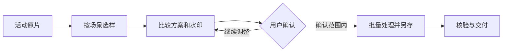

# 图修修 · 活动照片批量处理

把一批培训、会议、论坛等活动照片交给本地 AI 助手：先看代表样片，确认方案、强度和水印，再继续批量处理并另存，原片保留。

**版本：2.6.0** · [项目网站](https://img.chenshi.ai/) · [GitHub图文介绍](https://github.com/CSlawyer1985/tuxiuxiu) · [完整安装与自检](references/分享安装与皮肤模型.md)

## 第一次使用

1. 先准备支持本地 Skill 与脚本操作的助手，以及 Python 3.12—3.14。本轮实测为 Mac Apple 芯片、Python 3.14。
2. 解压后保留整个 `event-photo-retouch` 文件夹。Mac 双击“一键准备.command”，阅读提示后输入 `y`，准备独立运行环境并完成四模型实际推理自检。
3. 普通包已含模型，首次需联网准备运行库；Apple 芯片离线包还含对应运行库，但需要已有 macOS arm64 与 Python 3.14。两种包都不包含 Python 安装程序，独立环境约 400 MB。
4. 将完整 Skill 交给助手。在 Codex 的照片工作目录中，可请助手安装到 `.agents/skills/event-photo-retouch`；已有同名目录先核对，不覆盖。以 `$event-photo-retouch` 明确调用，未出现时重启 Codex。
5. 交给照片文件夹，先比较样片和三版水印，再确认当前批次的处理方向。

可以直接对助手说：

> 请使用图修修 Skill 处理这个活动照片文件夹。先选代表样片，展示原片与试修、参数和水印；我确认后再批量另存，保留原片。尚未准备环境时，先说明空间与联网情况，经我同意后准备。

## 能做什么

- 本地曝光、层次与色彩调整，逐批选样和参数微调。
- 四模型皮肤候选与原像素局部细化，肤色和磨皮范围分开。
- 活动水印、原片／试修对比、修改要求、批量另存与交付核验。

小脸、遮挡或五官不可靠时，相应连续皮肤暂缓磨皮并提示复核。自动初选、自检成功与测试通过，不等于每张照片效果已通过。不重绘人物，不改变身份、构图与现场事实。

## 使用与资源说明

[完整安装与选包](references/分享安装与皮肤模型.md) · [管线与网页选样](references/自动批量管线与网页选样.md) · [处理能力与效果边界](references/处理能力与效果边界.md)

官方模型来源、SHA-256和许可保存在 `assets/skin-model.json` 与 `assets/models/`。Windows尚未适配；Linux、Intel Mac及其他Python版本未在本轮实机验收。实际照片、运行数据库和环境缓存保存在用户活动或独立环境目录，随包仅提供必要源文件与明确许可的资源。

## 从选样到交付



完整环境检查可由助手执行：

```bash
python3 <skill-root>/scripts/setup_runtime.py doctor
```

尚未准备时，在当前用户同意后执行`setup --yes`；匹配离线包可加`--offline`。缺少模型、颜色依据或可见皮肤核对时，先处理缺口再进行对应修片，不绕过自检。
